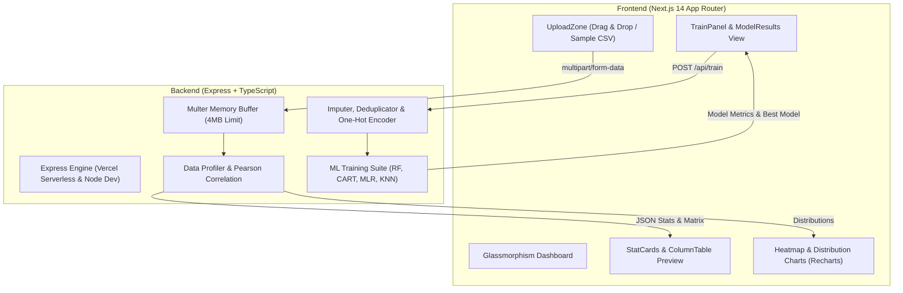

# 🔮 InsightLab

> **Browser-grade in-memory data profiling, interactive analytics, and multi-model machine learning benchmark suite with a modern Glassmorphism UI.**

InsightLab is an end-to-end full-stack data analytics and machine learning platform. It allows users to upload any tabular CSV file (up to 4MB) to instantly generate automated exploratory data analysis (EDA), statistical metrics, interactive Pearson correlation heatmaps, value distributions, and train multiple in-memory ML algorithms with a single click.

---

## 🌟 Key Features

- 💎 **Ultra-Modern Glassmorphism UI**: Built with dynamic floating gradient orbs, backdrop blur (`backdrop-blur-xl`), glowing gradients, interactive tooltips, and smooth animations.
- ⚡ **Zero-Database In-Memory Speed**: All computations, parsing, and machine learning model training occur in-memory within sub-seconds.
- 📊 **Automated Tabular Profiling**:
  - Instant row and column counts.
  - Automatic feature type inference (`numeric` vs `categorical`).
  - Missing value tracking and reporting.
  - Numerical summary statistics: Mean, Min, Max, and Unique counts.
- 🗺️ **Pearson Correlation Heatmap**: Color-coded correlation grid mapping pairwise relationships across all numerical features.
- 📈 **Dynamic Distributions**: Switch between column histograms (binned for numbers) or frequency breakdowns for categorical classes.
- 🤖 **Automated Machine Learning Benchmark**:
  - Automated deduplication and missing value imputation (Mean for numeric, Mode for categorical).
  - One-hot encoding for categorical features and label encoding for targets.
  - Automatic task detection: Numeric targets with >10 unique values are treated as **Regression**; otherwise classified as **Classification**.
  - Seeded 80/20 train/test split for deterministic benchmark reproducibility.
  - **Regression Suite**: Random Forest Regression, Decision Tree Regression, and Multivariate Linear Regression (evaluating $R^2$ and $RMSE$).
  - **Classification Suite**: Random Forest Classifier, Decision Tree Classifier, and K-Nearest Neighbors (evaluating $Accuracy$ and $Macro\ F1$).
  - Dynamic Best Model highlight and visual metric comparison bar chart.

---

## 🏗️ Architecture



---

## 🛠️ Tech Stack

### Frontend (`/client`)
- **Framework**: Next.js 14 (App Router)
- **Language**: TypeScript (Strict mode, zero `any`)
- **Styling**: Tailwind CSS + Custom Glassmorphism System
- **Icons**: Lucide React
- **Visualization**: Recharts

### Backend (`/server`)
- **Runtime**: Node.js + Express.js
- **Language**: TypeScript (Strict mode, zero `any`)
- **Parsing**: PapaParse
- **Validation**: Zod
- **File Handling**: Multer (In-memory storage)
- **Machine Learning**: `ml-random-forest`, `ml-cart`, `ml-regression-multivariate-linear`, `ml-knn`
- **Serverless Adapter**: Vercel Serverless Function entrypoint (`api/index.ts`)

---

## 🚀 Local Development Setup

### Prerequisites
- Node.js 18+ (tested on Node v20/v24)
- npm or pnpm

### 1. Clone the Repository
```bash
git clone https://github.com/Tawfiqul-Tamal/InsightLab.git
cd InsightLab
```

### 2. Run the Backend (`/server`)
```bash
cd server
npm install
npm run dev
# Server starts on http://localhost:4000
```

Verify backend health:
```bash
curl http://localhost:4000/api/health
# Returns: {"status":"ok"}
```

### 3. Run the Frontend (`/client`)
In a new terminal window:
```bash
cd client
npm install
npm run dev
# Client starts on http://localhost:3000
```

Open [http://localhost:3000](http://localhost:3000) in your browser. Click **"Use Sample Dataset"** to run an analysis and benchmark immediately!

---

## 🧪 Testing Backend Endpoints with cURL

### 1. Health Check
```bash
curl -X GET http://localhost:4000/api/health
```

### 2. Dataset Analysis
```bash
curl -X POST http://localhost:4000/api/analyze \
  -F "file=@server/sample/sample.csv"
```

### 3. Model Training (Regression Example)
```bash
curl -X POST http://localhost:4000/api/train \
  -F "file=@server/sample/sample.csv" \
  -F "targetColumn=exam_score"
```

### 4. Model Training (Classification Example)
```bash
curl -X POST http://localhost:4000/api/train \
  -F "file=@server/sample/sample.csv" \
  -F "targetColumn=tutoring"
```

---

## 🌐 Deployment to Vercel (Step-by-Step)

InsightLab is configured for quick deployment on Vercel as two decoupled projects:

### Step A: Deploy the Backend API
1. Log in to your [Vercel Dashboard](https://vercel.com).
2. Click **Add New** → **Project** and import `InsightLab`.
3. Set **Root Directory** to `server`.
4. Deploy. You will receive an API URL (e.g. `https://insightlab-api.vercel.app`).
5. Verify in browser: `https://insightlab-api.vercel.app/api/health` should display `{"status":"ok"}`.

### Step B: Deploy the Frontend Client
1. In Vercel, click **Add New** → **Project** and import `InsightLab` again.
2. Set **Root Directory** to `client`.
3. Add Environment Variable:
   - `NEXT_PUBLIC_API_URL` = your server URL from Step A (e.g., `https://insightlab-api.vercel.app`, no trailing slash).
4. Click **Deploy**.

### Step C: Configure CORS
1. In your **Server project** on Vercel: go to **Settings** → **Environment Variables**.
2. Add `CLIENT_URL` = your live Client URL from Step B (e.g. `https://insightlab-client.vercel.app`).
3. Redeploy the server project.

---

## 🔗 Live Demo & Screenshots

- **Live URL**: *(Add your deployed Vercel URL here)*
- **API Health**: *(Add your deployed API URL/api/health here)*

### Dashboard Preview
```
+--------------------------------------------------------------------------------+
|  InsightLab           [Glassmorphism MVP]                  [Upload New CSV]    |
+--------------------------------------------------------------------------------+
|  Total Records        Total Columns        Missing Cells     Numeric Features  |
|  120                  8                    0                 5                 |
+--------------------------------------------------------------------------------+
|  [Column Details] [Top 10 Rows Preview]                                        |
|  student_id (numeric) | study_hours (numeric) | exam_score (numeric) ...       |
+--------------------------------------------------------------------------------+
|  Feature Correlation Heatmap            Column Value Distribution (Histogram)  |
|  [Color-coded Pearson Grid]             [Recharts Vivid Cyan/Violet Bars]      |
+--------------------------------------------------------------------------------+
|  Train & Benchmark ML Models                                                   |
|  Target Column: [ exam_score ]  Task: Regression   [Train Models Button]       |
+--------------------------------------------------------------------------------+
|  Benchmark Results: Best Model: Linear Regression (MLR) (R2: 0.9986)           |
|  [Glass Comparison Table with Glow Badge]  [Comparative Bar Chart Visualizer]  |
+--------------------------------------------------------------------------------+
```

---

## 📄 License
MIT License. Created by [Tawfiqul Tamal](https://github.com/Tawfiqul-Tamal).
