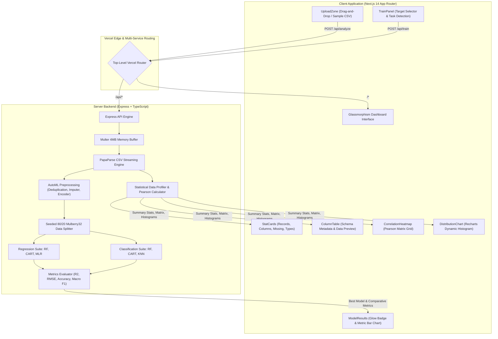

<div align="center">

# 🔮 InsightLab

### High-Performance In-Memory Tabular Intelligence & Automated Machine Learning Benchmark Suite

[](https://insightlab-kappa.vercel.app/)
[](https://nextjs.org/)
[](https://expressjs.com/)
[](https://www.typescriptlang.org/)
[](https://tailwindcss.com/)
[](https://opensource.org/licenses/MIT)

<p align="center">
  <a href="https://insightlab-kappa.vercel.app/"><strong>Explore the Live Application »</strong></a>
  <br />
  <a href="https://insightlab-kappa.vercel.app/api/health">API Health Status</a>
  ·
  <a href="#-quickstart--local-development">Quickstart Setup</a>
  ·
  <a href="#-rest-api-documentation">API Documentation</a>
  ·
  <a href="#-machine-learning-benchmark-engine">AutoML Architecture</a>
</p>

</div>

---
## 📌 Table of Contents

- [Overview & Motivation](#-overview--motivation)
- [Key Features](#-key-features)
- [System Architecture](#-system-architecture)
- [Machine Learning Benchmark Engine](#-machine-learning-benchmark-engine)
- [Design System (Glassmorphism)](#-design-system-glassmorphism)
- [Repository Structure](#-repository-structure)
- [Quickstart & Local Development](#-quickstart--local-development)
- [REST API Documentation](#-rest-api-documentation)
- [Production Deployment](#-production-deployment)
- [Privacy, Performance & Security](#-privacy-performance--security)
- [Roadmap](#-roadmap)
- [Author & License](#-author--license)

---

## 💡 Overview & Motivation

Data exploration and predictive modeling traditionally require complex Python environments, heavy Jupyter notebooks, and manual library setups (Pandas, Scikit-Learn, Matplotlib).

**InsightLab** eliminates that friction. It is a zero-database, in-memory data intelligence sandbox designed to analyze tabular CSV datasets and benchmark multiple machine learning algorithms within sub-seconds—all accessible directly through an ultra-modern glassmorphic web dashboard.

### Why InsightLab?
- ⚡ **Zero Infrastructure Overhead**: No PostgreSQL, MongoDB, or Redis required. Everything processes securely in-memory.
- 🔒 **Privacy-First Design**: Uploaded datasets are never written to disk or persisted in a database.
- 🎯 **Automated ML Pipelines**: From automated schema inference and imputation to one-hot encoding, model training, and comparative evaluation in a single roundtrip.

---

## 🌟 Key Features

### 📊 1. Automated Tabular Profiling
- **Real-Time Data Ingestion**: Instant streaming upload and parsing of CSV datasets up to 4MB.
- **Automated Type Inference**: Dynamically determines whether each feature is `numeric` or `categorical`.
- **Descriptive Statistics**: Real-time computation of **Mean**, **Min**, **Max**, **Unique Values Count**, and **Missing Value Counters** for all features.
- **Top 10 Row Previewer**: Interactive table view allowing rapid visual inspection of the raw dataset.

### 🗺️ 2. Pearson Correlation Heatmap
- Generates a full $N \times N$ pairwise Pearson correlation matrix for all numerical attributes.
- Custom-built glassmorphism color-coded grid mapping coefficients from $-1.00$ (strong negative correlation) to $+1.00$ (strong positive correlation) with interactive hover states.

### 📈 3. Dynamic Distribution Visualizer
- Dynamic feature picker dropdown enabling instant switching between columns.
- **Numeric Features**: Computed histogram bins ($k$-bin frequency partitioning) rendered with gradient fills.
- **Categorical Features**: Top categorical frequency breakdown displaying relative occurrences.

### 🤖 4. In-Memory AutoML Benchmark Suite
- **Deduplication**: Automatically drops redundant identical records.
- **Automated Imputation**: Replaces missing values using statistical **Mean** for numeric columns and **Mode** for categorical columns.
- **Feature Encoding**: Automatic one-hot encoding for multi-class categorical features and label encoding for target outputs.
- **Task Detection**: Automatically identifies task type:
  - $\text{Unique Target Values} > 10 \text{ and Numeric} \longrightarrow \textbf{Regression}$
  - $\text{Otherwise} \longrightarrow \textbf{Classification}$
- **Reproducible 80/20 Train/Test Split**: Deterministic seeded shuffling using Mulberry32 PRNG.
- **Multi-Algorithm Training**: Concurrently trains and evaluates 3 distinct ML models, identifies the top-performing model, and renders interactive metric comparison charts.

### 🌗 5. Dual-Theme Glassmorphism (Light & Dark Modes)
- **One-Click Theme Toggle**: Switch effortlessly between Dark Mode and Frosted Light Mode via the navigation toggle button.
- **Persistent Caching**: Leverages `localStorage` to retain the user's theme preference across browser refreshes and sessions.
- **Contrast-Preserving Design**: Recharts graphs, correlation matrices, schema tables, and badges dynamically adjust contrast, gridlines, axis colors, and hover states for accessibility in both modes.

---

## 🏗️ System Architecture



---

## 🤖 Machine Learning Benchmark Engine

| Task Type | Detection Criteria | Models Trained | Evaluation Metrics |
| :--- | :--- | :--- | :--- |
| **Regression** | Target is numeric AND contains $>10$ unique values | 1. **Random Forest Regression**<br>2. **Decision Tree Regression**<br>3. **Multivariate Linear Regression (MLR)** | • Coefficient of Determination ($R^2$)<br>• Root Mean Squared Error ($RMSE$) |
| **Classification** | Target is categorical OR has $\le 10$ unique values | 1. **Random Forest Classifier**<br>2. **Decision Tree Classifier**<br>3. **K-Nearest Neighbors (KNN)** | • Classification Accuracy ($Accuracy$)<br>• Macro F1-Score ($Macro\ F1$) |

### Preprocessing & Feature Engineering Flow
1. **Deduplication**: Drops duplicated sample rows using fast JSON hash-set lookups.
2. **Missing Value Imputation**:
   $$\text{Numeric: } x_{\text{missing}} = \mu_x \quad\Big|\quad \text{Categorical: } x_{\text{missing}} = \text{mode}(x)$$
3. **Encoding**: One-hot expands categorical feature columns into binary numeric representations; maps classification targets into contiguous integer indices $[0, 1, \dots, C-1]$.
4. **Deterministic Partitioning**: Fixed-seed pseudo-random shuffle allocates $80\%$ of rows to training and $20\%$ to validation.
5. **Model Benchmarking**: Models are trained and tested strictly on unseen hold-out sets to prevent data leakage.

---

## 💎 Design System (Dual Glassmorphism)

InsightLab features a custom-engineered dual-mode glassmorphic aesthetic:

| Element | Dark Mode Glassmorphism 🌙 | Frosted Light Mode Glassmorphism ☀️ |
| :--- | :--- | :--- |
| **Background Canvas** | `bg-gradient-to-br from-[#060814] via-[#0b0f2a] to-[#041c24]` | `bg-gradient-to-br from-[#f8fafc] via-[#eff6ff] to-[#f0fdfa]` |
| **Ambient Floating Orbs** | 3 saturated Gaussian orbs (`purple-700`, `teal-500`, `blue-700`) | 3 soft pastel Gaussian orbs (`indigo-300`, `teal-200`, `sky-200`) |
| **Glass Cards** | `bg-white/10 backdrop-blur-xl border border-white/20` | `bg-white/75 backdrop-blur-xl border border-white/80 shadow-[0_8px_30px_rgb(0,0,0,0.06)]` |
| **Primary Typography** | Crisp `text-white/95` with `text-white/60` secondary | Deep `text-slate-900` with `text-slate-600` secondary |
| **Buttons & Badges** | Violet-to-cyan gradient with electric hover aura | Violet-to-cyan gradient with luminous lift |
| **Tables & Heatmaps** | Translucent rows with `white/5` hover & glowing cells | Frosted rows with soft slate hover & high-contrast values |
| **Charts Integration** | Light axis tick text (`fill-white/70`), subtle gridlines | Dark slate axis tick text (`fill-slate-700`), clean gridlines |

---

## 📁 Repository Structure

```
InsightLab/
├── vercel.json                 # Unified multi-service routing config
├── README.md                   # Comprehensive repository documentation
├── .gitignore                  # Monorepo build and environment ignores
│
├── client/                     # Next.js 14 Frontend Application
│   ├── app/
│   │   ├── globals.css         # Tailwind directives, animations & glass styles
│   │   ├── layout.tsx          # Root layout with ThemeProvider and Inter font
│   │   └── page.tsx            # Main reactive dashboard page
│   ├── components/
│   │   ├── ThemeToggle.tsx     # One-click Sun/Moon light/dark mode switcher
│   │   ├── UploadZone.tsx      # CSV drag-and-drop zone + sample dataset loader
│   │   ├── StatCard.tsx        # KPI summary metric cards
│   │   ├── ColumnTable.tsx     # Schema metadata & top 10 preview tabs
│   │   ├── CorrelationHeatmap.tsx # Custom grid Pearson correlation visualizer
│   │   ├── DistributionChart.tsx  # Dynamic Recharts binned histogram visualizer
│   │   ├── TrainPanel.tsx      # Target column selector & AutoML trigger
│   │   ├── ModelResults.tsx    # Benchmark leaderboard table & bar chart
│   │   ├── Skeleton.tsx        # Shimmer loading placeholders
│   │   └── Toast.tsx           # Glassmorphic error and status notifications
│   ├── context/
│   │   └── ThemeContext.tsx    # Global React Theme Context & localStorage sync
│   ├── public/
│   │   └── sample.csv          # Bundled student performance sample dataset
│   ├── types/                  # Strict TypeScript interface declarations
│   ├── tailwind.config.ts      # Custom keyframes and darkMode class extensions
│   ├── tsconfig.json           # Next.js TypeScript compiler options
│   └── package.json
│
└── server/                     # Express.js In-Memory API Backend
    ├── api/
    │   └── index.ts            # Vercel serverless function entrypoint
    ├── sample/
    │   └── sample.csv          # 120-row student academic performance dataset
    ├── src/
    │   ├── app.ts              # Express app setup, CORS, and Multer 4MB limits
    │   ├── index.ts            # Local development listener (port 4000)
    │   ├── routes/
    │   │   ├── health.ts       # GET /api/health
    │   │   ├── analyze.ts      # POST /api/analyze
    │   │   └── train.ts        # POST /api/train
    │   ├── utils/
    │   │   ├── analyze.ts      # Statistical profiling & Pearson correlation math
    │   │   └── ml.ts           # Preprocessing, model training & metrics evaluation
    │   └── types/              # Strict TypeScript definitions & ML module declarations
    ├── tsconfig.json           # Strict CommonJS TypeScript configuration
    └── package.json
```

---

## 🚀 Quickstart & Local Development

### Prerequisites
- [Node.js](https://nodejs.org/) v18.0.0 or higher (Node v20+ recommended)
- `npm` or `pnpm`

### 1. Clone the Repository
```bash
git clone https://github.com/Tawfiqul-Tamal/InsightLab.git
cd InsightLab
```

### 2. Setup and Run the Backend (`/server`)
```bash
cd server
npm install
npm run dev
```
The Express server will start locally at **`http://localhost:4000`**.  
Verify health:
```bash
curl http://localhost:4000/api/health
# Output: {"status":"ok"}
```

### 3. Setup and Run the Frontend (`/client`)
Open a separate terminal window:
```bash
cd client
npm install
npm run dev
```
The Next.js dashboard will start at **`http://localhost:3000`**.

Visit [http://localhost:3000](http://localhost:3000) in your browser. Click **"Use Sample Dataset"** to immediately load and analyze the student academic performance dataset!

---

## 🧪 REST API Documentation

### 1. Health Check
Checks API operational status.
- **Method**: `GET`
- **Path**: `/api/health`
- **Response**:
```json
{
  "status": "ok"
}
```

---

### 2. Dataset Analysis
Uploads and profiles a CSV file in-memory.
- **Method**: `POST`
- **Path**: `/api/analyze`
- **Content-Type**: `multipart/form-data`
- **Body**:
  - `file`: CSV file binary (up to 4MB)

**cURL Example**:
```bash
curl -X POST http://localhost:4000/api/analyze \
  -F "file=@server/sample/sample.csv"
```

**Response Format**:
```json
{
  "rowCount": 120,
  "columns": [
    {
      "name": "study_hours",
      "type": "numeric",
      "missingCount": 0,
      "uniqueCount": 58,
      "mean": 5.48,
      "min": 2.2,
      "max": 9.0
    },
    {
      "name": "parental_education",
      "type": "categorical",
      "missingCount": 0,
      "uniqueCount": 4
    }
  ],
  "correlationMatrix": {
    "columns": ["study_hours", "attendance_percentage", "exam_score"],
    "matrix": [
      [1.00, 0.94, 0.98],
      [0.94, 1.00, 0.96],
      [0.98, 0.96, 1.00]
    ]
  },
  "topRows": [
    {
      "student_id": 1,
      "gender": "Female",
      "study_hours": 6.5,
      "exam_score": 84
    }
  ],
  "distributions": {
    "study_hours": {
      "type": "numeric",
      "bins": [
        { "binStart": 2.2, "binEnd": 2.88, "count": 12 },
        { "binStart": 2.88, "binEnd": 3.56, "count": 16 }
      ]
    }
  }
}
```

---

### 3. Model Benchmark Training
Preprocesses the uploaded dataset, detects the predictive task, and concurrently trains 3 machine learning models.
- **Method**: `POST`
- **Path**: `/api/train`
- **Content-Type**: `multipart/form-data`
- **Body**:
  - `file`: CSV file binary (up to 4MB)
  - `targetColumn`: Name of the target column to predict

**cURL Example (Regression)**:
```bash
curl -X POST http://localhost:4000/api/train \
  -F "file=@server/sample/sample.csv" \
  -F "targetColumn=exam_score"
```

**Response Format**:
```json
{
  "taskType": "regression",
  "targetColumn": "exam_score",
  "bestModel": "Linear Regression (MLR)",
  "models": [
    {
      "name": "Random Forest Regression",
      "metrics": { "R2": 0.9947, "RMSE": 0.9652 }
    },
    {
      "name": "Decision Tree Regression",
      "metrics": { "R2": 0.9926, "RMSE": 1.1422 }
    },
    {
      "name": "Linear Regression (MLR)",
      "metrics": { "R2": 0.9986, "RMSE": 0.4899 }
    }
  ],
  "trainRows": 96,
  "testRows": 24
}
```

---

## 🌐 Production Deployment

InsightLab is configured for seamless deployment on **Vercel** as a unified multi-service monorepo via the root `vercel.json`:

```json
{
  "$schema": "https://openapi.vercel.sh/vercel.json",
  "services": {
    "client": { "root": "client", "framework": "nextjs" },
    "server": { "root": "server", "framework": "express" }
  },
  "rewrites": [
    { "source": "/api/(.*)", "destination": { "service": "server" } },
    { "source": "/(.*)", "destination": { "service": "client" } }
  ]
}
```

### Benefits of this Deployment Model:
1. **Unified Origin**: Both frontend and backend share the identical production URL (`https://insightlab-kappa.vercel.app`).
2. **Zero CORS Friction**: Browser requests hit `/api/*` directly on the same domain without cross-origin preflight overhead.
3. **Automated CI/CD**: Pushing to the `main` branch triggers atomic builds for both services.

---

## 🔒 Privacy, Performance & Security

- **In-Memory Volatility**: Data uploaded to InsightLab is processed solely inside ephemeral Node.js memory buffers and released immediately after response generation. No data is stored in databases, caches, or filesystems.
- **Memory Buffer Caps**: Strict 4MB payload limits are enforced at the Multer middleware level to guard against serverless memory exhaustion.
- **Strict TypeScript Validation**: All data structures and parameters are validated using Zod schemas with strict TypeScript typings (zero usage of `any`).

---

## 🗺️ Roadmap

- [x] Initial Glassmorphism UI & Dashboard
- [x] In-memory statistical profiling and Pearson correlation heatmap
- [x] Concurrency AutoML training (Regression: RF, CART, MLR | Classification: RF, CART, KNN)
- [x] Unified Vercel multi-service deployment
- [x] **Dual-Mode Glassmorphism**: Persistent Light Mode & Dark Mode with one-click Theme Toggle
- [ ] **Export Model Weights**: Enable one-click download of trained model parameters in JSON format
- [ ] **PDF Executive Summary**: Download comprehensive analytical reports with chart visualizations
- [ ] **WebAssembly ML**: Client-side offline inference option using ONNX Runtime Web

---

## 👨‍💻 Author & License

### Author
**Md. Tawfiqul Islam Tamal**  
- **GitHub**: [@Tawfiqul-Tamal](https://github.com/Tawfiqul-Tamal)  
- **Live Demo**: [https://insightlab-kappa.vercel.app](https://insightlab-kappa.vercel.app)  

### License
This project is open-source and distributed under the terms of the **[MIT License](https://opensource.org/licenses/MIT)**.

```
Copyright (c) 2024 Md. Tawfiqul Islam Tamal
```

---

<div align="center">
  <sub>Built with ❤️ by <a href="https://github.com/Tawfiqul-Tamal">Md. Tawfiqul Islam Tamal</a></sub>
</div>
